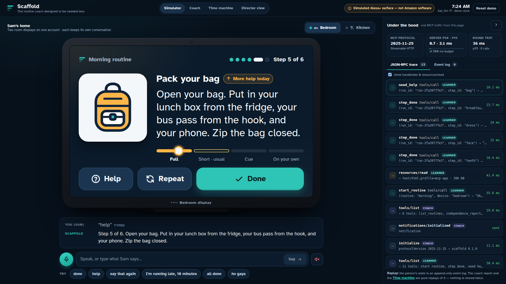
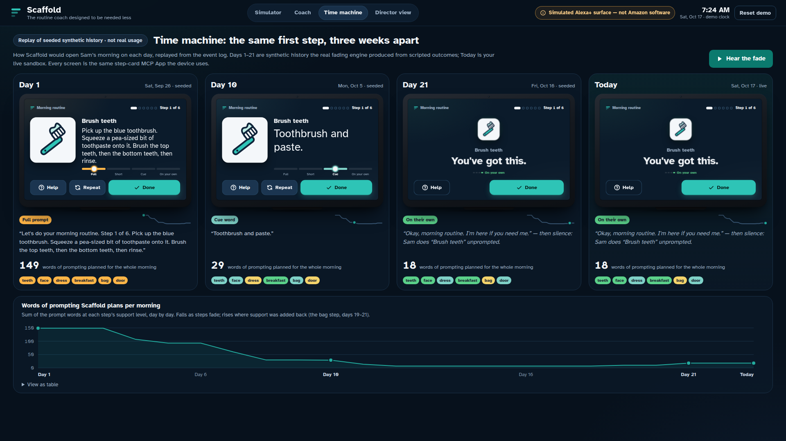
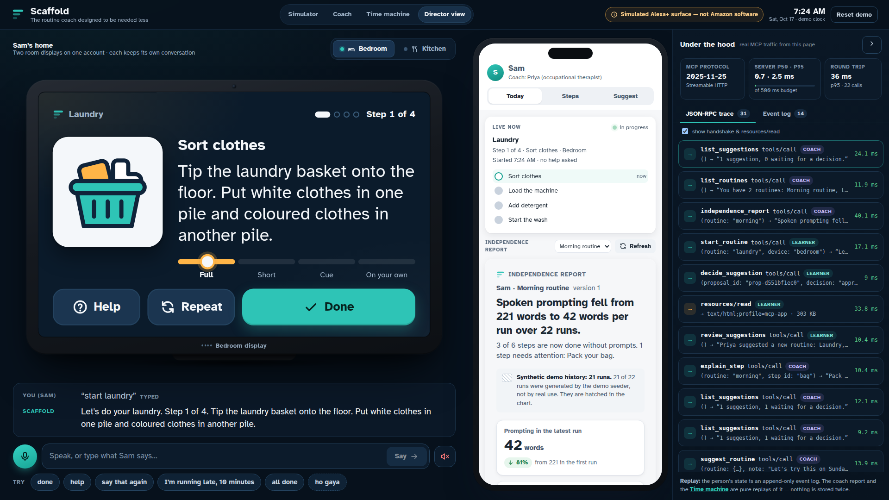

# Scaffold — the routine coach designed to be needed less

Alexa+ track · Amazon Developer Hackathon 2026

Scaffold coaches adults with cognitive disabilities through daily routines such as getting ready, doing laundry or making tea. As each step is learned, it fades its own prompts:

> full prompt → short prompt → cue word → silence

When a step gets harder again, support comes back on its own. Every change comes with a written reason that can be audited.

Scaffold is a self-hosted MCP server using Streamable HTTP and MCP spec 2025-11-25, which is what Alexa+ for Builders consumes. Alexa+ does the talking. Scaffold holds the state, applies the rules and supplies the exact words, and it runs no LLM. Rich cards for the Echo Show screen are MCP Apps (`ui://` resources).

The Alexa+ developer toolkit is open only to partners, so this repo includes a simulated Alexa+ surface: a web page that is a real MCP client and a real MCP Apps host. Every screen is labelled "Simulated Alexa+ surface — not Amazon software". It doesn't run on an Echo, and it isn't affiliated with or certified by Amazon. All people and history in the demo are synthetic.

## Try it live
https://tjncr2jv6v7sqw6jw467fbdyha0pesly.lambda-url.ap-southeast-2.on.aws/ needs no sign-in, no keys and no install.
- It opens the simulated Echo Show. Say or type "start my morning".
- Three newer routines start at full prompts: "take my medicine", "let's make lunch" and "catch the bus".
- The mic uses the browser's speech service, which works in Chrome, Edge and Safari. Plain Chromium builds have none, so type instead.
- Each browser session gets its own seeded sandbox.
- It runs on AWS Lambda and DynamoDB in Sydney and stays up through the judging period.
- The MCP endpoint is the same address followed by `/mcp`. To get a token, see [Use it from any MCP client](#use-it-from-any-mcp-client).



| Time machine, replayed from the event log | Learner device and coach view side by side |
|---|---|
|  |  |

## What you'll see
- **The routine gets quieter as the person learns.** On Day 1 the first step is *"Step 1 of 6. Pick up the blue toothbrush. Squeeze a pea-sized bit of toothpaste…"*. On Day 10 it's *"Toothbrush and paste."* On Day 21 there's silence. Open Time machine to watch this replayed from the event log.
- **"Help" adds one level of support, for that step only.** If help is needed two runs in a row, support is added back and the coach is told why: *"Added support back (cue to partial) because help was needed in 2 runs in a row (Oct 16, Oct 17)."*
- **"Where was I?"** resumes the same run on another device, so the person can move from the bedroom to the kitchen.
- **The learner owns their routines.** A coach can only suggest a routine, and it takes effect only when the learner says "yes".
- **The routines come from the research.** The demo covers mornings, a cold lunch, a pill-box medicine routine and catching the bus. Published studies name these as the daily tasks where adults with intellectual disability or brain injury most often need support, and say that task analysis with faded prompts teaches them. Sources, quotes and limits are in [docs/RESEARCH_BASIS.md](docs/RESEARCH_BASIS.md).
- **The words are always the same.** The same state always produces exactly the same words, which many learners need. With no LLM in the server, tool calls stay well inside the Alexa+ 500 ms budget; server p95 is in single-digit milliseconds.

## Quick start (no keys, no cloud)
You need Node.js 22.18 or later (see `.nvmrc`), which runs the server's TypeScript directly with no build step. On an older Node, `npm ci` stops with an engines error.

```bash
npm ci
npm run build      # MCP App cards + the simulator web app
npm start          # http://127.0.0.1:8787  (MCP endpoint: /mcp)
```

Open http://127.0.0.1:8787 and say or type "start my morning". Then try "done", "help", "where was I?" (on the Kitchen device), "I'm running late, 10 minutes" and "all done". Each browser session gets its own seeded sandbox. Other pages:
- `/coach`: the coach's phone view, with the independence report, step explanations, level overrides and "suggest a routine".
- `/time-machine`: Day 1, Day 10, Day 21 and Today, replayed from the same log.
- `/?layout=split`: the device and the coach side by side, as in the demo video.

## Use it from any MCP client
| | |
|---|---|
| Endpoint | `http://127.0.0.1:8787/mcp` (Streamable HTTP, stateless). `/mcp-json` serves clients that accept only `application/json` |
| Protocol | `2025-11-25` (initialize handshake). The same tools also answer 2026-07-28 clients |
| Auth | `Authorization: Bearer demo-learner` or `Bearer demo-coach` locally. With no header you get the local demo learner |

```bash
# MCP Inspector (CLI)
npx -y @modelcontextprotocol/inspector@2.11.0 --cli http://127.0.0.1:8787/mcp --transport http --method tools/list
npx -y @modelcontextprotocol/inspector@2.11.0 --cli http://127.0.0.1:8787/mcp --transport http \
  --method tools/call --tool-name start_routine --tool-arg routine=morning

# Any other MCP client that supports Streamable HTTP: point it at http://127.0.0.1:8787/mcp
```

**On the hosted server**, there's no shared learner, so create a private sandbox first. It's seeded with the same 21 days of synthetic history, and its tokens last 6 hours.

```bash
URL=https://tjncr2jv6v7sqw6jw467fbdyha0pesly.lambda-url.ap-southeast-2.on.aws
TOKEN=$(curl -s -X POST $URL/api/demo/sandbox | node -p 'JSON.parse(require("fs").readFileSync(0)).learnerToken')
npx -y @modelcontextprotocol/inspector@2.11.0 --cli $URL/mcp --transport http \
  --header "Authorization: Bearer $TOKEN" --method tools/list
```

The same response also includes a `coachToken` for the 6 coach tools.

### Tools (the list depends on the role in the token)
| Learner (11) | What it does |
|---|---|
| `start_routine` | Starts or resumes a routine. Each step is presented at the support level it has earned |
| `step_done` | Moves to the next step. Idempotent by `step_id`, so a retry never skips a step. `all_remaining` finishes the steps the learner does on their own in one go |
| `need_help` | Gives one more level of support for this step in this run, and records it |
| `repeat_step` | Says the same words again |
| `where_was_i` | Resumes from any device |
| `running_late` | Keeps the must-do steps, drops optional steps that don't fit, and doesn't count against progress |
| `skip_step` | Skips the current step today |
| `my_progress` | The learner's own view of which steps they now do alone |
| `review_suggestions`, `decide_suggestion` | The learner approves or declines a coach's suggestion |
| `list_routines` | Lists routines and any run in progress |

| Coach (6) | What it does |
|---|---|
| `independence_report` | Words of prompting per run, per-step levels, steps needing attention, and every change with its reason |
| `explain_step` | One step's level history and the runs that caused each change |
| `suggest_routine` | Validates a routine (errors block it, warnings advise) and queues it for the learner's approval |
| `set_step_level` | Overrides a step's level. A reason is required and recorded |
| `list_suggestions`, `list_routines` | Suggestion status and the routine list |

Every result includes a `speech` field with the exact words to say, and stable ids so one tool's result can feed the next. Step tools link `ui://scaffold/step-card.html`. The other MCP Apps are `independence-report`, `suggestions` and `progress`.

## How it works
- **One event log per person.** An append-only event log is the single source of truth. Levels, runs, reports and explanations are all computed from it (`src/core/engine.ts`).
- **Fading rules.** After 3 runs in a row without help, a step fades one level. After 2 runs in a row with help, one level of support comes back and the step is flagged. Levels never skip a rung, and property-based tests check this.
- **Concurrency.** Each person's commands run one at a time. Every write checks that the log hasn't changed since it was read: in SQLite through a transaction and the primary key, in DynamoDB through a conditional `TransactWriteItems` with a check on the last item. Command ids make a retry safe after an uncertain commit.
- **Storage.** SQLite (`node:sqlite`) by default, in-memory for tests, DynamoDB on AWS.
- **Security.** Tool lists scoped to the caller's role, Host and Origin validation, JSON-only errors, and stateless HMAC sandbox tokens. Details are in [docs/THREAT_MODEL.md](docs/THREAT_MODEL.md).

The code is in `src/core` (the domain logic, with no I/O), `src/store`, `src/server` (MCP and HTTP), `src/apps` (MCP Apps views and the original pictograms) and `src/web` (the simulated surface, the coach view and the time machine).

## Tests
```bash
npm test              # unit, property, store contract, MCP-over-HTTP, review regression and web router tests
npm run typecheck
npm run test:e2e      # browser end-to-end tests (Playwright with the cached Chromium); results in docs/evidence/TEST_RUNS.md
```

## Deploy to AWS (near-zero cost, capped)
The live demo runs from `infra/template.yaml` (AWS SAM), which creates:
- a Lambda function (arm64) with a public Function URL, serving `/mcp`, the demo API and the simulator;
- a DynamoDB table (on-demand, encrypted at rest), with a TTL for demo sandboxes;
- a CloudWatch error alarm;
- a $20/month cost cap that enforces itself. At 100% of actual spend (before credits), an AWS Budget publishes to SNS, and a guard Lambda sets the app's reserved concurrency to 0, so every request is throttled and nothing more is spent. Email alerts also go out at 80%, and when spend is forecast to reach the cap.

```bash
STACK=scaffold REGION=us-east-1 BUDGET_EMAIL=you@example.com scripts/deploy-aws.sh   # AWS CLI only; tags everything Project=$STACK
aws lambda delete-function-concurrency --function-name <FunctionName output>        # lift the cap after a review
aws cloudformation delete-stack --stack-name scaffold                                # teardown
```

The script deploys in two passes, because the Function URL host is only known after the first one; the second pass sets it as the Host allowlist. It generates the sandbox-token secret once, in the git-ignored `data/` folder. The deployment record, including the end-to-end run against the live URL and a live test of the cost cap, is in [docs/evidence/aws/DEPLOYMENT.md](docs/evidence/aws/DEPLOYMENT.md).

## Configuration
See `.env.example`. A local demo needs none of it.

## Limitations
- No real Alexa+ or Echo integration, because the partner toolkit isn't available to us. The surface is simulated and labelled as such.
- No proactive push. Add-ons can't push yet, so a real deployment would pair Scaffold with a native Alexa Routine, such as "start my morning" at 7:00.
- The demo uses fixed and sandbox bearer tokens. Production would use Alexa account linking (OAuth 2.1 with PKCE).
- Prompts are in English. The simulated router also accepts a few Hinglish commands ("ho gaya", "madad").
- The prompt ladders follow published task-analysis practice, but no practitioner has reviewed them for this product yet.

## Provenance and licences
- All code in this repository was written during the hackathon submission period, starting 2026-10-17. It doesn't extend any earlier project.
- Licence: Apache-2.0 (`LICENSE`).
- Typeface: Atkinson Hyperlegible (Braille Institute), SIL Open Font License 1.1.
- The pictograms were drawn for this project.
- Major dependencies:
  - `@modelcontextprotocol/*` (MIT)
  - Express (MIT)
  - zod (MIT)
  - Preact (MIT)
  - AWS SDK for JavaScript v3 (Apache-2.0)
  - serverless-http (MIT)
