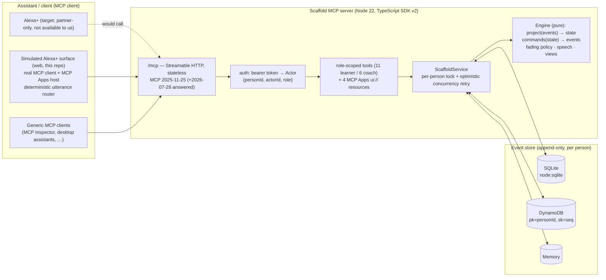

# Scaffold — High-Level Design

## Key decisions (details in `DECISIONS.md`)
- **Alexa+ is the language model; Scaffold is the system of record.** Alexa+ handles understanding, conversation and rendering. Scaffold owns state, rules and the exact words. There is no LLM on the server, so tools respond in milliseconds, within the 500 ms Alexa+ budget.
- **Event sourcing.** The only truth is an append-only, per-person event log. Support levels, run state, reports and level-change explanations are pure projections of that log. As a result:
  - Replay is deterministic, which the "time machine" uses.
  - Every level change can be explained from the runs that caused it.
  - Concurrency control is a simple check of the expected last sequence number.
- **Stateless Streamable HTTP.** A fresh `McpServer` is built per request for the calling actor. This fits Lambda and Function URLs, and it makes `tools/list` itself role-scoped.
- **MCP Apps for rich media.** Tools declare `_meta.ui.resourceUri`. Each view is a single self-contained HTML file rendered in a sandboxed iframe by any MCP Apps host: Alexa+ supports the extension, and our simulator hosts it via `@modelcontextprotocol/ext-apps` AppBridge. Taps on a card are real `tools/call` requests.
- **Simulated Alexa+ surface, honestly labelled.** The web app is a real MCP client. Its deterministic router stands in for Alexa+'s language understanding (NLU) and is labelled as a simulation in the UI.

## Deployment views
| Mode | Command | Store | Notes |
|---|---|---|---|
| Local (judge reproduction) | `npm ci && npm run build && npm start` | SQLite file `data/scaffold.db` | No keys; seeds 21 days of synthetic history on first boot |
| Tests | `npm test` | memory, SQLite in a temp directory, mocked DynamoDB | Includes real-HTTP MCP client tests |
| AWS | `scripts/package-lambda.sh` then `sam deploy` (`infra/template.yaml`) | DynamoDB on-demand | Lambda arm64 with a Function URL, a CloudWatch error alarm and an optional $5 budget. **Not deployed yet: no credentials.** |

## Request flow: "done"
1. The client sends `tools/call step_done {run_id, step_id}` with a bearer token.
2. Host and Origin are checked, then auth maps the token to the actor (learner `sam-…`).
3. `ScaffoldService.execute` acquires the person's lock and loads the cached projection, catching up from the store with `seq > lastSeq`.
4. `cmdComplete` decides. If the step is already done it emits nothing (`duplicate: true`). Otherwise it emits `step.completed`, plus `run.finished` if this was the last step.
5. The store appends with `expectedLastSeq`. On conflict the service re-reads and retries.
6. The service applies the events to the projection. The fading policy runs inside the projection of `step.completed`.
7. The tool builds `StepResultOut`, which contains:
   - the verbatim `speech`;
   - the next `step`;
   - any `level_changes`.

   It returns `structuredContent` and a text fallback. The host renders `ui://scaffold/step-card.html` with the result.
